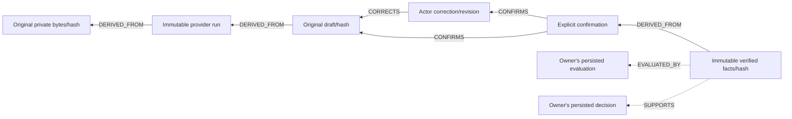

# Evidence lineage — issue #46

Implementation candidate on `feat/46-evidence-lineage`, composing pending PR68/PR70/PR72. #43 production membership/backfill/grant administration remains an integration gate. The main AppModule is not enabled by this branch.

## Stored history

`DraftLineageWriter` executes inside the same PostgreSQL transaction as draft/correction/confirmation/outbox changes. A sink failure rolls back all those changes. No successful-extraction links are created before an actual draft exists.



Solid links derive from actual stored OCR records. Dashed links require the owning match/decision adapter: `EvaluationLineageWriter` resolves persisted tenant-authorized version snapshots in the caller's transaction, checks source association/hash and current permissions. Actual #50/#53 adapter integration has not occurred. Clients/models have no link-writing endpoint.

Immutable snapshots retain resource/version/content hash and bounded private metadata: source hash/media/size/retention, provider/model/prompt/run/usage, original-field hashes, correction actor/revision/value hashes, confirmation identity and frozen payload hashes. Values remain in their authorized source/draft stores. `blob-1` identifies the original bytes; the evidence API's processing revision is separate. Current retention/legal-hold metadata remains on `GET evidence/{id}`. Retention changes/deletion administration and legacy migration require owner integration; nothing here purges data.

Tenant-qualified keys/foreign keys preserve scope. SQL triggers reject UPDATE/DELETE. Concurrent replay deduplicates; conflicting same-version snapshot/link hashes fail instead of replacing history. This preserves application/database history; it is not a cryptographic ledger or protection against a database superuser.

## Authorization and pagination

`MembershipEvidenceResolver` first invokes existing `AuthService`/compatible `verifyToken`, then resolves current active membership server-side. `X-Tenant-ID` is a selector, never a grant. `MembershipEvidenceAccess` requires a current authority for all reads/downloads/provider/worker boundaries. That authority must deny unknown actions/resources and apply current ACL/retention. There is no permissive production fallback.

The acceptance authority is explicitly confined to `infra/lineage/validate-runtime.cjs`, with labelled SQL membership/ACL/PO tables. It proves existing RS256/JWKS verification and live SQL revocation through this composition; it does not prove a production Keycloak realm, #43 migration/RLS or grant administration.

`GET /platform/v1/evidence/{id}/lineage?limit=25&cursor=...` checks the source and both endpoints of every link, then rechecks disclosed resources. Unauthorized links/IDs are omitted; authority outages fail closed. Foreign roots return generic 404. An empty page can still have a next cursor when scanned links were unauthorized.

Pages scan 1..100 committed links (default 25), ordered by numeric sequence. Per-source transaction locks preserve allocation/commit order. The first page freezes a committed watermark; later appends appear in a fresh traversal. AES-256-GCM cursors hide internal sequences and authenticate tenant/principal/source/watermark/15-minute expiry. Every page checks current permissions. Key rotation invalidates old cursors. Optional `next_cursor`, limit/cursor parameters and max 100 links are proposed contract additions requiring A/C review.

`GET /platform/v1/evidence?q=...&retention_class=STANDARD` adds case-insensitive literal filename substring search (1..128 characters) and retention filtering. SQL always predicates tenant before per-resource checks. `%` is literal. Evidence cursors bind the exact search/retention filter, tenant and principal. Filtering restricted metadata grants no access. No unreviewed-model-text or cross-tenant search is provided. These optional parameters are also proposed contract additions.

## Evidence and reproduction

Local checks: 638 API unit tests/40 suites, 234 HTTP E2E tests/10 suites, API build/lint and contract validation passed. The [final runtime report](evidence/issue46-lineage-runtime-20261014224858696.json) records 11 passing groups, a 10,946 ms extractor run and four provider HTTP attempts with 10,045 conservative reserved tokens. Unit/HTTP suites label doubles; runtime reports separately use real services. No new dependency was added: the recorded Node crypto, PostgreSQL, Nest, JWT/JWKS, MinIO, PDF.js, ClamAV and Gemini integrations are reused.

```powershell
npm.cmd ci --ignore-scripts --no-audit --no-fund
npm.cmd run build:api
docker compose -f infra/lineage/compose.yaml config --quiet
docker compose -f infra/lineage/compose.yaml up -d
# Wait for actual signature update/load; stale scanners fail readiness.
node infra/lineage/validate-runtime.cjs --live --env-file <ignored-server-env-path>
npm.cmd run test:api
npm.cmd run test:e2e --workspace=apps/api -- --runInBand
npm.cmd run test:contracts
npm.cmd run lint:api
docker compose -f infra/lineage/compose.yaml stop
```

The isolated `opendx-issue46` project uses loopback ports 15446/19446/33146 and independent persistent volumes. Compose extends the pinned #41 scanner barrier and uses `!override`; validate installed Compose supports it. Stopping preserves all volumes/originals. Proposed SQL reserves no shared migration number.

The live runner reads only server key/model, uses one exact hash-allowlisted fictional dev PDF, synthetic-only disclosure and fixed small quotas. Gold labels open after extraction. Repeated dev input is backend integration evidence, not independent accuracy evaluation. Existing AuthService verifies actual RS256 signatures/issuer/audience/expiry against ephemeral local JWKS. Signing keys are never persisted. Membership/ACL/PO data and the fault after actual lineage SQL are labelled fixtures; downstream remains PENDING.

Timestamped reports `docs/ai/evidence/issue46-lineage-runtime-*.json` preserve failures/reruns, exact source hashes, checks and provider usage. The first attempt exposed lexicographic ordering of a text-cast sequence alias; corrected runs verify numeric order and equality of paginated/full visible link IDs. Other runtime checks cover forged/expired/wrong-audience JWTs, tenant selection, revoked worker membership before provider I/O, foreign IDs/search/download/drafts/operations, per-node ACL omission, transaction rollback, concurrent deduplication, immutable hash conflicts and append-only triggers.

CI on the published SHA, peer review, #43 production composition/backfill and actual match/decision adapters remain closure gates. Production SSO, process-kill/coordinated restore, retention administration and legacy/system acceptance are not established by these fixtures.
