# Reviewed OCR drafts — issue #26

Status: implementation on `feat/26-ocr-reviewed-drafts`; depends on pending #38/PR68 and #41/PR70. Local integration merges preserve those dependency commits. No issue closure, independent review, production tenancy or executed matching is implied by this document. The main AppModule is not enabled until the verified identity/tenant and pack adapters are integrated.

## Behavior

```mermaid
flowchart LR
  A[Private accepted bytes] --> B[Real AV and actual hash]
  B --> C[CLEAN source]
  C --> D[Durable extraction intent]
  D --> E[Bounded PDF/image preflight]
  E --> F[Gemini row count and field suggestions]
  F --> G[Persisted REVIEW_REQUIRED draft]
  G --> H[Append-only actor corrections]
  H --> I[Required-field review and exact validation]
  I --> J[Current tenant/PO/supplier authorization]
  J --> K[Atomic confirmation and immutable facts/outbox]
  K --> L[PENDING authorized pack dispatch]
```



`DraftService`/`PostgresDraftStore` implement tenant-predicated durable requests, leased worker attempts, original suggestions/provider provenance, corrections and confirmations. A single PostgreSQL transaction updates the source processing state, draft, immutable confirmed payload, outbox and idempotency response. Command scope includes tenant/principal/method/route/key; replay returns the original response snapshot. Source and draft locks serialize concurrent commands. A stale revision or worker lease cannot confirm/publish an old result.

The worker verifies CLEAN actual bytes through the evidence service and rechecks source/ACL at every provider boundary. Both the authorized worker and the original server-recorded requester must still have resource access; worker privileges cannot substitute for a revoked initiating user. Storage corruption revokes file clearance and prevents dispatch. Retryable errors use persisted backoff (honoring provider Retry-After), at most three attempts and a 120-second lease; original source/failed attempt metadata remains retained.

The generic module receives an explicit verified context resolver, schema profiles, extraction port and durable target. The OpenResolve pack owns invoice field definitions, deterministic financial validation and current purchase-order/supplier binding checks. There is no client tenant/actor/CLEAN/verified-payload override. Public routes follow merged contracts:

| Route | Result |
| --- | --- |
| POST `/platform/v1/evidence/{id}/extractions` | 202 durable `Operation`; registered invoice schema, OCR mode |
| GET `/platform/v1/extraction-drafts/{id}` | Authorized persisted `ExtractionDraft` |
| POST `/platform/v1/extraction-drafts/{id}/corrections` | 200 updated draft, exact expected revision, original/new values and server actor/time |
| POST `/platform/v1/extraction-drafts/{id}/confirmations` | 202 immutable `Confirmation` and PENDING downstream operation |
| GET `/platform/v1/operations/{id}` | Shared evidence route delegates to an authorized draft operation reader |

MISSING fields have no original value; filling one must omit `previous_value`. Existing values require an exact previous-value match. Duplicate/unregistered paths, client identity and stale revisions fail. Original suggestions remain unchanged. Human corrections remove provider confidence and replace location claims with explicit UNKNOWN, preserving original evidence in history. Every required field must be acknowledged; optional missing SKU is allowed. Server code validates UUID/date/currency, quantity/price/tax scales, VAT 0..1 and declared line/invoice totals using the existing isolated 60-digit HALF_UP decimal implementation. AI performs no authoritative arithmetic, matching or payment approval.

## Bounds and source locations

- The first OCR profile supports 1..10 item rows (9 header fields plus up to 80 line fields). Ambiguous/missing/over-budget row counts fail closed and are not silently truncated. Structural line editing and larger invoice profiles remain explicit future capabilities.
- Input limits remain XML 5 MiB / PDF/PNG/JPEG 20 MiB from #41; this OCR profile accepts PDF/PNG/JPEG. PNG/JPEG headers must describe positive dimensions <=20,000 per axis and <=25 million pixels before provider dispatch.
- PDF.js 6.4.299 validates PDF in an isolated worker with a 10-second total deadline, 192/16 MiB JS heap, 4 MiB stack, <=30 pages, <=25 million estimated pixels/page at 150 DPI, <=100 million total page pixels, <=200,000 text codepoints and <=100,000 operators/page. Decoder image size is capped. Only byte input is supplied; evaluation/XFA/network fetching is disabled. Worker environment is empty and diagnostic streams are discarded. JS heap limits are not an OS-wide RSS limit.
- Unique verbatim values in actual PDF page text receive a one-based page and Unicode codepoint span in the stored parser-version snapshot. Duplicate/absent values, scanned PDFs and raster images retain UNKNOWN locations. No bounding box is guessed. Source text and model originals are retained privately with the immutable source hash.
- Source processing transitions are persisted as QUEUED → PROCESSING → REVIEW_REQUIRED → CONFIRMED, or FAILED. Every non-CLEAN quarantine state resets processing to NOT_STARTED and blocks new consumption.

PDF.js 6.4.299 requires Node >=22.13 or 24. This PR proposes Node >=24.14 for host/CI and pins the Node 24 Alpine image digest for API/web builds. Shared runtime/lockfile/CI/migration edits require A's integration review. Existing numbered migrations are untouched; files under `database/proposed/` only bootstrap isolated acceptance databases.

## Real evaluation, 2026-10-15 Asia/Saigon

The [final runtime report](evidence/issue26-ocr-runtime-20261014222959203.json) records exact source hashes, original run IDs/model/prompt/token usage, corpus hashes, all field outcomes and backend checks. Four wholly fictional Vietnamese documents cover text PDF, image-only scanned PDF, PNG and JPEG; two dev / two held-out. Gold labels were read after model extraction; fixture review and deliberate invalid-total corrections do not contribute to OCR accuracy. The [first run](evidence/issue26-ocr-runtime-20261014221444174.json) is retained. The final run repeats the same corpus/prompts after backend contract/state fixes, including schema validation of correction responses; it is repeated exposure to the same held-out set, not a new independent evaluation.

| Split | Documents | Exact field matches | Value-equivalent matches |
| --- | ---: | ---: | ---: |
| Dev | 2 | 34/34 | 34/34 |
| Held-out | 2 | 42/42 | 42/42 |

The digital PDF produced 11 verified text source spans; raster/scanned sources produced none. There were zero fixture corrections needed for measured extraction. Eleven runtime checks passed on actual PostgreSQL/MinIO/ClamAV/Gemini, including negative total validation, tenant-predicated foreign-ID access, a fault after actual SQL outbox insertion with full rollback, immutable model originals and same-key confirmation replay. Downstream rows correctly remain PENDING; no matching/payment completion is asserted.

This is a tiny clear synthetic corpus, not production accuracy or calibrated confidence. Extractor durations were 11,774–17,169 ms (four samples, nearest-rank p95 17,169 ms). The shared bounded provider made 16 HTTP request attempts, reserving 42,553 tokens. Provider reports total 16,253 tokens: prompt 9,673; candidates 2,167; thoughts 4,413; cached 0. At published standard rates on this date, the arithmetic estimate is USD 0.03192975 for this run; actual tier/billing is unverified and may differ. [Google pricing](https://ai.google.dev/gemini-api/docs/pricing).

Test identity is a static server fixture resolver. This does not establish production JWT/membership, actual process-kill/restore recovery or legacy invoice migration. #43/#46 integrate verified tenancy/lineage; the pack dispatcher integrates real domain matching. No automatic payment, invented XML signature or tax-authority verification is introduced.

Local regression on the proposed implementation passed 608 API unit tests and 234 HTTP E2E tests. HTTP tests use labelled identity/storage/provider/database doubles; the separate runtime report uses the real services described above. API/web build, lint, contract validation and the four existing web tests passed. The Node 24 Alpine API image also parsed the text and scanned PDF without network access. These checks do not replace peer review, CI on the published SHA or full system acceptance.

## Reproduce

```powershell
npm.cmd ci --ignore-scripts --no-audit --no-fund
npm.cmd run build:api
docker compose -f infra/ocr/compose.yaml up -d
# Wait for the initial foreground signature update and actual scanner readiness.
node infra/ocr/validate-runtime.cjs --live --env-file <ignored-backend-env-path>
```

The runner accepts only server-side Gemini key/model from that file, fixes synthetic-only disclosure and small request/token ceilings, and allowlists exact corpus hashes. It never sends labels or credentials in model text and makes no production-data calls. Each run writes a timestamped artifact, retaining earlier attempts. Identity/PO-binding fixtures and injected failure are labelled. Containers use a separate `opendx-issue26` project and loopback ports 15426/19426/33126; stopping retains all raw data and volumes.

```powershell
npm.cmd run test:api
npm.cmd run test:e2e --workspace=apps/api -- --runInBand
npm.cmd run test:contracts
npm.cmd run build
npm.cmd run lint
docker compose -f infra/ocr/compose.yaml stop
```

The committed corpus is versioned. The generator `infra/ocr/create-fixtures.cjs` uses existing PDFKit/Noto Sans and Playwright; Windows generation recorded installed Chrome 154.0.8037.100 via `PLAYWRIGHT_CHANNEL=chrome` because pinned-browser download timed out. Do not overwrite published sources/reports when changing layouts; create a new corpus version. Preserve all PDF.js/font/CMap/ICC/WASM/canvas notices and upstream binaries. [Mozilla release](https://github.com/mozilla/pdf.js/releases/tag/v6.4.299), [Node support](https://nodejs.org/en/about/previous-releases).
