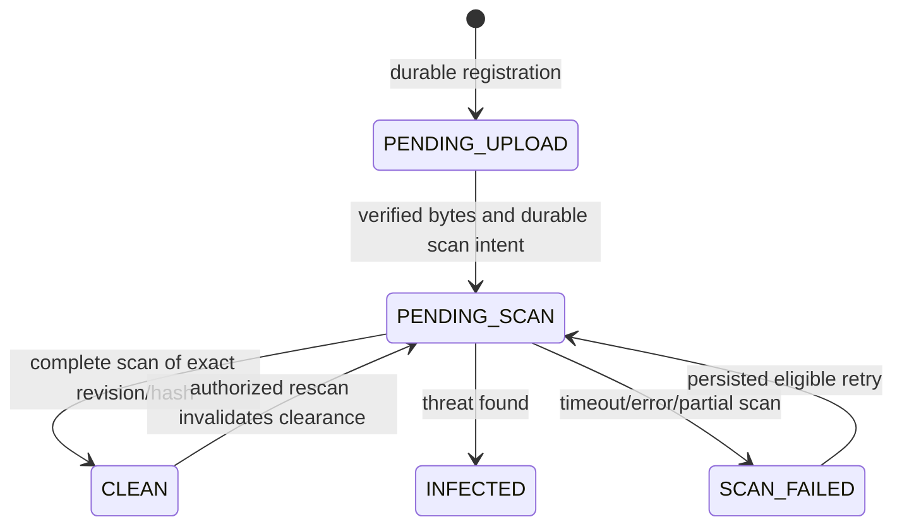

# Secure evidence intake and quarantine — issue #41

Status: implementation draft for peer review, 2026-10-14 (Asia/Saigon). Owner B/@huybitvvt; reviewer A for authorization/storage/recovery and C for user-visible states. Branch `feat/41-secure-evidence-intake` is based on develop@02b6748, including merged PR #67. The Nest module, PostgreSQL repository, private MinIO adapter and ClamAV scanner are implemented and exercised in an isolated fixture. Main AppModule composition remains disabled pending #43 verified tenancy. See [runtime instructions and limits](../../infra/evidence/README.md) for implemented behavior and outstanding release gates.

Tracking: [#41](https://github.com/hieunofun/AI-Powered-DX-OS/issues/41), merged [#37](https://github.com/hieunofun/AI-Powered-DX-OS/issues/37) contracts and [#38 implementation PR #68](https://github.com/hieunofun/AI-Powered-DX-OS/pull/68), awaiting peer acceptance. HTTP response tests validate against the merged schemas. This draft does not mark #41 complete or enable extraction persistence (#26).

## Problem and scope

PR3 validates XML/PDF size/signatures and archives bytes, but has no scan/quarantine gate or tenant-aware evidence API. `MinioStorageService.upload` verifies size and metadata.sha256 after write; it does not independently recompute stored content SHA-256. `AuthenticatedUser` currently has no verified tenant. The existing XML parser blocks DTD/entity declarations and unsupported profiles. These behaviors are inherited regression requirements, not proof of target tenancy or malware safety.

Deliver generic registration, bounded byte upload, durable scan operations, authorized metadata/list/download and reusable CLEAN-byte access for #26 OCR. Pack-specific invoice interpretation remains in the pack. No storage URLs, client tenant overrides, new public rescan API, clean bypass, automatic payment action, document rendering or bulk historical-data migration is included. The full tenant backfill/grant implementation remains #43/#46.

## Architecture and ownership

The future implementation belongs in the reviewed platform evidence boundary. Its concrete path and shared composition/migration edits are coordinated with A's #40 work; this draft does not preempt that refactor.

| Port / responsibility | Required behavior |
| --- | --- |
| Verified context/resource access | Resolve active tenant and subject from independently verified identity/server membership; check action, resource ACL and pack grant on every request and worker dispatch. Never construct context from public JSON, filenames or X-Tenant-ID. |
| Evidence repository | Tenant-predicated registration/read/guarded updates; append-only scan history; unique idempotency and scan-attempt records; transactionally persist operation and outbox. |
| Evidence storage | Accept verified context and server-generated evidence/revision; derive private object key internally; bounded streams; immutable source bytes; independent content hash verification. |
| Antivirus scanner | One immutable revision/hash in, bounded CLEAN/INFECTED/FAILED result out; record engine/signature versions and scan policy version. No authorization decisions. |
| Scan worker | Claim durable lease, check current source/state/context, scan/recompute hash, then compare-and-set the exact revision/lease token. Persist retries and reconcile uncertain outcomes. |
| CLEAN-byte reader | Recheck ACL, quarantine classification, source revision/hash and any revocation before download or external AI dispatch. |

Core services own generic metadata/operations; pack schemas remain outside core. The #38 Gemini adapter receives CLEAN bytes only from this worker/reader integration. Its direct synthetic evaluation CLI is not a target intake endpoint. Target routes stay disabled until a real verified-context adapter is available; a test double cannot establish tenant isolation.

## HTTP behavior

Use the reviewed OpenAPI request/response shapes; strict unknown-field rejection applies. All errors echo X-Correlation-ID and the shared code/message/correlation_id/retryable envelope. Operation reads reauthorize the original resource. Foreign-tenant and absent UUIDs produce identical 404 responses.

| Operation | Success | Checks / error behavior |
| --- | --- | --- |
| POST /platform/v1/evidence | 201 RegistrationResult | evidence.register; registered MIME, byte length/hash and retention policy; durable metadata plus idempotency result. Server UUID/revision/tenant/actor/time; protected upload entitlement expires in 15 minutes. |
| PUT /platform/v1/evidence/{id}/content | 202 Operation | evidence.upload, PENDING_UPLOAD, unexpired entitlement and scoped key; stream size, declared/actual MIME and SHA-256 must agree. No success before durable accepted operation exists. |
| GET /platform/v1/evidence / {id} | 200 | evidence.read plus per-resource ACL; metadata remains readable for blocked files. Cursor bound to tenant/principal/filter, default 25, maximum 100. |
| GET /platform/v1/evidence/{id}/content | 200 bytes | evidence.download plus CLEAN/current revision; attachment-only, nosniff, safe server-generated Content-Disposition; no raw object key or signed/public URL. |
| GET /platform/v1/operations/{id} | 200 Operation | operation.read plus ACL on original resource; no leakage of other tenants' jobs. |

Missing/bad JWT is 401; missing verified tenant is 400 TENANT_CONTEXT_REQUIRED; membership dependency outage is 503. MIME mismatch is 415; excess bytes 413; checksum mismatch 422 CHECKSUM_MISMATCH. Stale revisions/idempotency/state/unclean files use the corresponding 409 shared code. Capacity exhaustion uses 429 QUOTA_EXCEEDED and Retry-After. Unavailable storage/scanner uses 503 DEPENDENCY_UNAVAILABLE with operation_id when persisted. New internal scan reasons are bounded non-PII details, not invented public error enums; any necessary enum/path change goes through contract review.

## Upload limits and file safety

| Media | Maximum registered and actual bytes | Required preflight |
| --- | ---: | --- |
| application/xml | 5,242,880 | UTF-8 decoding; XML signature; no binary/control bytes or DTD/entities; bounded structural parsing after scan; known pack parser before business intake. |
| application/pdf | 20,971,520 | PDF signature agrees with MIME; antivirus scans its embedded content; encryption/scan-limit alerts block processing. |
| image/png | 20,971,520 | PNG signature agrees with MIME; scanner and subsequent bounded decoder. |
| image/jpeg | 20,971,520 | JPEG signature agrees with MIME; scanner and subsequent bounded decoder. |

The schema's global 20 MiB maximum is not an XML allowance: registration and upload both apply the media-specific 5 MiB XML maximum. Exactly-at-limit input is accepted when all other checks pass; one byte over is rejected while streaming. Bound chunk buffers to 64 KiB and terminate excess streams; do not rely on Content-Length. Zero bytes are invalid. Do not fetch user-supplied URLs or unpack top-level ZIP/Office/executable uploads. Original filename is sanitized display metadata, never a path/storage key.

XML validation runs before acceptance in an isolated worker: 2-second deadline, 64 MiB old-generation/16 MiB young-generation heap, 2 MiB stack, maximum nesting 64 and 10,000 elements. UTF-8 and its declaration must agree; DTD, custom entities, invalid character references and malformed XML are rejected without entity resolution or business intake. Domain parser/profile, PDF page and image decoder/pixel budgets belong to #26; magic bytes and an AV result do not prove parseability. No inline preview is enabled by #41.

## State machine and exact revision

Quarantine and processing are separate fields. Every non-CLEAN classification has NOT_STARTED processing and denies download/OCR; an authorized metadata read remains possible. A later negative rescan removes access immediately and aborts further stream delivery/processing. Already delivered bytes cannot be recalled. INFECTED has no user override; revisions or replacement evidence do not erase the original record.

Each scan result binds `(tenant_id, evidence_id, content_revision, object_identity, sha256, scan_attempt_id, lease_token, policy_version)`. Finalize through an atomic state/revision/lease guard. An old worker cannot publish CLEAN after retry/replacement/revocation. Scan/read hashing uses the actual immutable stream, not just object metadata. If bytes differ from registered metadata or the object changes, fail the operation and deny access; retain evidence for reconciliation.

For download or AI dispatch, buffer at most the media limit in process memory under two service-instance slots; reads have a 15-second total deadline. This implementation creates no temporary disk files. Allow memory headroom for readback, concatenation and XML workers; it does not provide a distributed tenant quota. Verify complete actual SHA before consumer invocation or success headers, then recheck ACL/revision/CLEAN. HTTP downloads recheck before each 64 KiB chunk and have a 30-second delivery deadline. An integrity error atomically revokes CLEAN to SCAN_FAILED/RECONCILIATION_REQUIRED and appends history. Accepted MinIO source/history remains retained.

## ClamAV decision and limits

The isolated fixture uses **ClamAV 1.4.6 LTS**, unmodified external service, with Node-owned socket framing and no libclamav linking. Upstream source commit: `5853e1396777bae4d909cd3dd44f58352e7cf9b3`; annotated tag object `26071af7b26cd71e66b13dcbe4bcb6bae8a8c2be`. The pulled image is pinned to `sha256:b5b910ce43d595bf8a2fe401e34db56434602b2c755b7c2b07f00c917d04d469`; the tagged COPYING notice is preserved under docs/open-source/notices. Production security/SBOM/source-distribution and supervisor review remain release gates.

ClamAV is GPLv2. Preserve its exact [tagged license](https://github.com/Cisco-Talos/clamav/blob/clamav-1.4.6/COPYING.txt) and applicable distribution/source notices with the service. Follow the existing [license policy](../open-source/LICENSE_POLICY.md); the application adapter is team-authored MIT code. No license compliance or competition-eligibility conclusion is asserted by this proposal.

Use private Unix socket where deployment permits; otherwise an isolated internal scanner network with no published host port. Only the scan worker connects; clamd has no public auth boundary. Send `zINSTREAM` followed by 4-byte big-endian chunk lengths, 64 KiB chunks and zero terminator. Support fragmented replies and require exactly one bounded NUL-terminated result (8 KiB maximum). Do not send daemon-visible paths or filename-derived commands. References: [protocol](https://docs.clamav.net/manual/Usage/ClamdProtocol.html), [pinned configuration](https://github.com/Cisco-Talos/clamav/blob/clamav-1.4.6/etc/clamd.conf.sample).

Proposed team configuration:

| Setting | Value | Reason |
| --- | --- | --- |
| StreamMaxLength / MaxFileSize | 20M / 20M | Covers the maximum accepted source/embedded item |
| MaxScanSize | 100M | Bound recursive decompressed content |
| MaxRecursion / MaxFiles | 10 / 1000 | Bound nested work; test limit alerts |
| AlertExceedsMax | yes | Partial scanning cannot masquerade as a clean result |
| AlertEncryptedDoc / AlertEncryptedArchive | yes / yes | Encrypted content blocks clearance |
| MaxThreads / MaxQueue | 2 / 4 | Bound daemon work and queue |
| scanner deployment cap | 2 CPUs / 4 GiB RAM / 64 processes | Proposed container ceilings; validate signature-load/scan capacity on the real stack |
| concurrent spools / reserved bytes | 4 / 80 MiB | Reserve bounded temporary disk before acceptance; stop admission when exhausted |
| worker deadline / reply limit | 30 seconds / 8 KiB | Covers connect, send, scan and receive |
| signature freshness gate | at most 24 hours | Worker rejects stale/unavailable definitions; policy choice, not upstream default |
| worker attempts / lease | at most 3 / 60 seconds | Persisted bounded retries; recover lost workers |

Important upstream limitation: in this version MaxScanTime is documented as applying only to ZIP. It cannot provide a general PDF/XML deadline. Enforce the worker deadline independently, resource-cap the scanner and use a supervisor to recover wedged capacity. Closing the client socket does not prove daemon scanning stopped; do not dispatch unlimited replacement scans. Readiness includes engine version, complete fresh signatures, supported INSTREAM, available capacity and the reviewed policy version.

Only complete `stream: OK` on the correct hash under a healthy/fresh scanner allows CLEAN. `FOUND` means blocked: threat signatures map to INFECTED; encryption/limit/incomplete-scan policy alerts map to SCAN_FAILED with a permanent bounded reason. Unknown alert classes are blocked. ERROR, EOF, oversized/malformed reply, stale definitions, disconnect and deadline never allow CLEAN. PING alone does not establish scan readiness. Scan signature name/version is bounded metadata, not raw clamd logs.

## Durable upload, retry and reconciliation

1. In a transaction, authorize and persist registration or upload intent, scoped idempotency record and operation. Persisted accepted work has a stable operation_id; database failure before intent returns 503 without accepted success.
2. Derive `tenant/<UUID>/evidence/<UUID>/revision/<n>` privately. Write a bounded staging object, compute SHA-256 from incoming bytes, and verify actual stored bytes/hash before switching a durable reference. Keep objects immutable; concurrent writers cannot replace a referenced revision.
3. Transactionally finalize the reference, PENDING_SCAN state and scan outbox item. A DB failure after object write leaves a recorded uncertain operation; recovery checks actual bytes/hash/reference before redispatch. Never infer completion from object metadata alone.
4. Worker claims the durable job/lease and records attempts before scanner I/O. Commit result and history/outbox together. Duplicate delivery/recovered leases must not create duplicate terminal transitions or lose raw evidence.

Scope keys by tenant+principal+method+route+key, bind canonical JSON or validated byte SHA-256. Same key and same validated payload returns/resumes the original authorized operation. Changed payload returns 409 IDEMPOTENCY_CONFLICT. Pending/uncertain uploads reconcile before accepting a competing writer. Invalid/incomplete byte attempts do not produce accepted success or re-executable confirmed work. Entitlement expiration is checked before accepting new bytes; already accepted durable work can finish after expiry. Replayed status/results still require current authorization.

Use persisted safe retry attempts with jittered 1/2/4-second backoff, maximum three; no process-local timer as the only recovery mechanism. Stop on authorization, integrity, permanent parser/scan-policy failures or exhaustion. Capacity outages preserve operation and source references, and remain blocked. After exhaustion, authorized manual retry is an internal operation under a reviewed service action grant; a new public endpoint is outside this contract. Record a new scan attempt, retain old history and recheck ACL/source/definitions. Worker crash/lease timeout is not a clean result.

## Retention and deployment recovery

Initial policy performs no automatic physical deletion of accepted raw evidence, INFECTED files, uncertain uploads or legal-hold objects. Expired empty registrations retain metadata/history; abandoned staging objects are reconciliation candidates, not silently deleted. Storage quota exhaustion denies new work before accepting bytes. Physical cleanup requires a separately reviewed retention decision proving no durable reference, active lease, unresolved operation or legal hold; no broad bucket purge/volume deletion is authorized by #41.

Restore storage and evidence/operations/history consistently; invalidate stale leases, verify hashes and keep incomplete scans blocked until rescanned with current definitions. Keep the PR3 invoice bucket/migrations intact; tenant legacy-object mapping/backfill is #43/#62. New migrations obtain their number from develop at integration time, coordinated by A; this design reserves no migration number. Service/worker metrics expose tenant-safe counts, scan duration, definition age, pending/failed jobs and retry exhaustion, never raw bytes, credentials or scanner result text containing unbounded names.

## Review and acceptance

The [acceptance matrix](SECURE_EVIDENCE_INTAKE_ACCEPTANCE.md) separates actual isolated results, doubles and pending release checks. A reviews verified context, shared composition, numbered migration and recovery boundaries; C reviews blocked/pending messages. The proposed SQL is applied only to the isolated fixture. Obtain peer review/CI, #38 acceptance and the remaining runtime checks before enabling or merging; #41 stays open.

Official sources checked 2026-10-14: [1.4.6 release](https://github.com/Cisco-Talos/clamav/releases/tag/clamav-1.4.6), [1.4 LTS announcement](https://blog.clamav.net/2025/01/clamav-14-as-next-long-term-stable-lts.html), [GPLv2 classification](https://docs.clamav.net/), [versioned configuration](https://github.com/Cisco-Talos/clamav/blob/clamav-1.4.6/etc/clamd.conf.sample), [protocol](https://docs.clamav.net/manual/Usage/ClamdProtocol.html). Resource/retry/freshness values above are proposed project policy, not claimed upstream defaults.
